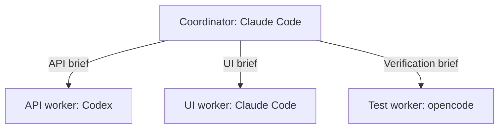

# Teams: one coordinator across multiple sessions

Status: first release implemented. See the README's Teams section for the shipped controls
and setup. The graph uses a coordinator tree with automatic layout; arbitrary placement,
automatic wake-ups and dependency edges remain future work. This document retains the design
direction for those later additions.

## Product intent

A team connects one coordinator session to several worker sessions. The user supplies a
goal, chooses which sessions participate, and decides how much the coordinator may do.
The graph is the editable representation of those connections and their current activity.

This should work across Claude Code, Codex and opencode. A session remains an ordinary
agentctl session: it can still be read, messaged, attached to, interrupted and reviewed.

The graph, storage, waiting, delivery and status updates make no model calls. When a
coordinator reasons about the work or gives new instructions, those turns consume its
normal model allowance. Supervision must be opt-in; opening a team never wakes an agent.

## First-version scope

- One coordinator and multiple workers per team.
- Connect existing sessions or launch a session through the existing new-session flow.
- Assign each worker a role, brief and permitted interaction level.
- Save the team and its layout; inspect and change connections interactively.
- A coordinator can inspect and delegate to connected workers through scoped MCP tools.
- A coordinator can propose worker topology changes within a human-set permission ceiling;
  a human reviews and applies those changes.
- A shared activity feed records assignments, results, delivery states and human actions.
- Automatic wake-ups, nested coordinators and worker-to-worker dependency routing come later.

Start with this hierarchy rather than a general workflow engine. Coordination ownership and
task dependencies are different relationships; introducing both at once would make the
first graph harder to understand and the execution rules harder to trust.

## Example

The coordinator can ask the API worker for an endpoint, read its result, and pass the
contract to the UI worker. The user can inspect every handoff and take over any session.
Workers never gain authority over each other's permission menus.

## Interactive setup and daily use

1. Choose **Create team** from the command palette and name the goal.
2. Choose an existing coordinator session or launch one. Verify whether that session has
   the scoped agentctl MCP connection available. Do not claim that an arbitrary running
   agent can acquire new tools without its provider's support; show a reconnect or relaunch
   step when necessary.
3. Select **Add worker**, choose or launch a session, and give it a role and brief.
4. Select the coordinator, choose **Connect**, then select the worker. This adds a saved
   connection with an explicit permission level. Connecting alone sends no messages.
5. Review the bindings and choose **Start run**. Preview the initial brief before sending it.
6. Follow activity in the graph and feed. A node opens its existing session views; a
   connection shows the instructions, delivery receipts and results routed through it.

Use one team screen with a graph and an inspector. Nodes show role, agent, task name and
plain-text status. Status and connection types must use text or line patterns alongside
color. Use no emoji. Avoid putting transcripts, full prompts and controls on every node.

The first editor should be keyboard-first: select a node, activate Connect, and select its
destination. Support mouse selection too. Dragging lines can be added without becoming the
only way to make connections. A phone uses a connection list and the same inspector and
forms. The two presentations edit the same model.

Preserve the existing navigation and composer behavior. Session selection, inspection and
terminal attachment remain distinct actions. Replies reuse the existing composer, including
its fixed recipient, saved drafts, pending state and duplicate-submit protection. Editing
the graph must never silently send a message or change an open composer's destination.

Topology edits are saved as drafts while a run is active. Applying them is an explicit
action, and already-issued assignments keep their original binding. Removing a connection
revokes future coordinator dispatches without closing the underlying session.

## Permissions and human control

Each connection has one of three interaction levels:

| Level | Coordinator can do |
|---|---|
| Observe | Read activity and request linked-worker transcripts |
| Propose | Prepare a worker message for the user to review and send |
| Delegate | Send or queue work within the connection's saved scope |

Propose is the default. Delegate requires an explicit user selection. Keep permission
approval, denial, adoption and session termination under the existing human controls.

Enforce membership and grants in the daemon on every coordinator tool call. The current
global `--allow-write` switch is not sufficient to represent team-scoped delegation. A
saved graph or a system prompt is not authorization by itself. Identify the team, run and
coordinator through a scoped MCP connection, and revalidate the target binding and grant
at dispatch time. This is application-level scope control, not an OS sandbox between
same-user processes.

One worker has one active coordinator writer by default. Other teams may observe it. A
human takeover pauses delegated dispatches to that worker until explicitly resumed. Taking
over does not erase its assignments or detach the user's terminal.

**Pause team** stops future routing and automatic work. It does not interrupt work already
running. **End run** closes the orchestration run while leaving agent sessions available.
Interrupting an individual agent remains a separate, explicit action.

## Runtime and token behavior

The coordinator is an ordinary session with a team-specific MCP connection. Initial tools
should expose the team, connected-worker state, scoped transcript reads, delegation,
assignment results and waiting. Reuse the existing send, queue and launch implementations
behind the scoped policy checks.

Do not forward every tool call or stream full transcripts into the coordinator. Record
activity locally. When the coordinator asks, provide changes since a cursor, assignment
status and bounded excerpts or artifact references. Full transcripts remain available on
demand. Retain the existing treatment of other agents' transcripts as untrusted data.

First version:

- Model-driven coordination occurs when the user sends the coordinator a goal or follow-up.
- Waiting uses local MCP waiting, not repeated model turns asking for progress.
- No automatic coordinator wake-ups, periodic AI summaries, or retry-until-success loops.
- A user's connection edits and status checks never become model prompts.
- Completion notifications and result previews use recorded output and local Git evidence.

A later optional **On results** mode can wake the coordinator after selected assignments
finish. Coalesce simultaneous completions into one message and require explicit limits on
coordinator wake-ups, handoffs, concurrent workers and elapsed time. Reaching a limit pauses
routing. Show token usage when available, but do not promise a precise hard token budget
across adapters with incomplete usage reporting.

## State and delivery semantics

Keep these concepts separate:

- **Team:** goal, coordinator, saved policy and graph revision.
- **Member:** stable role identity with an explicit binding to a session.
- **Connection:** source, target, permission, scope and enabled state.
- **Run:** a particular execution of the goal using a frozen graph revision.
- **Assignment:** brief, worker binding, originating coordinator turn and result references.
- **Dispatch:** a particular delivery intent and its receipt.
- **Run event/checkpoint:** durable progress and the last consumed event cursor.

Session liveness is not task correctness. A worker becoming idle means its turn stopped;
it does not prove an assignment succeeded. Use assignment states such as draft, dispatched,
reported complete, needs review, accepted, failed and blocked. Keep the agent's claim and
the user's acceptance separate.

Persist records in the existing local SQLite store. Store orchestration events and a
dispatch outbox transactionally; use stable dispatch IDs and event cursors to deduplicate
triggers. Do not use the in-memory event bus as the only recovery mechanism: its slow
subscribers can lose events, and session event rings are bounded.

Delivery through tmux cannot offer a transactional exactly-once guarantee. After a crash
between typing a message and recording its receipt, mark delivery unknown and require
inspection. Do not automatically replay it. This extends the current command-history
behavior rather than introducing a conflicting receipt system.

If a worker exits, mark its binding unavailable and retain the role and assignments. A
replacement session must be explicitly bound; an old assignment must not drift to another
session with a similar title. If the coordinator or daemon exits, retain the graph and run
history and resume routing only after an explicit resume action.

## Later dependency support

Add worker-to-worker dependencies after the coordinator hierarchy works well. Represent
these as a distinct edge type: **B waits for A's accepted result**. They are scheduling
relationships, not permission to message or control another session.

Validate dependency cycles. Make the release condition explicit: reported completion,
human acceptance or a configured local check. A handoff carries the relevant result and
artifact references, with its provenance. Independent workers remain parallel. Start with
one coordinator level; arbitrary nested teams should not be part of the initial release.

## Integration points

- Add team models alongside `agentctl/models.py`, keeping session and assignment state distinct.
- Add a dedicated `agentctl/daemon/teams.py` service for graph validation, runs and dispatches.
- Extend `agentctl/daemon/registry.py` with versioned SQLite migrations and orchestration tables.
- Expose team RPCs through `agentctl/daemon/server.py`; keep policy in the service.
- Extend `agentctl/mcp.py` with scoped team tools and coordinator identity.
- Add `agentctl/tui/teams.py` for the graph, inspector and builder; reuse session views and composer.
- Expose creation, inspection, pause and resume through CLI commands using the same service.
- Add daemon feature negotiation so an older daemon yields a clear compatibility state.

Do not create a separate LLM backend or a second agent execution engine. Use the existing
adapters, launched sessions, command ledger, transcript readers and local review evidence.

## Delivery order and acceptance criteria

1. **Saved topology:** create teams, bind existing sessions, connect roles and persist layout.
   Build the keyboard forms and phone connection list before elaborate canvas gestures.
2. **Scoped coordination:** wire a real coordinator through MCP, enforce grants, delegate
   one assignment and read its result. Include a manually reviewed proposal path.
3. **Recovery and live graph:** persist run events and dispatch intent, expose receipts,
   implement pause/takeover, and reconnect without reissuing work.
4. **Optional automation:** add bounded event-driven wake-ups and dependency edges after the
   preceding behavior is reliable.

The first release is ready when a user can connect a coordinator to workers from multiple
providers, inspect their permissions, delegate through the coordinator, see full results,
take over a worker, and reopen the same team without losing bindings or resending work.

Regression coverage should include scope rejection, duplicate events, unknown delivery,
daemon restart, missing sessions, coordinator exit, permission prompts, human takeover,
and graph edits during an open message draft. Use fake adapters and MCP clients for these
tests; automated tests must not spend model tokens.
